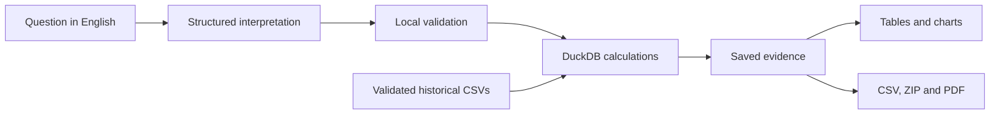

<div align="center">

# Interactive Airport Data Platform

### From everyday questions to evidence-backed aviation insights.

Explore airport connectivity, uncover delay patterns, compare airlines, and understand
aircraft activity through natural-language questions and reproducible local calculations.

**Natural-language analytics | Interactive exploration | Evidence-backed reports**

[Get started](interactive-airport-data-platform/QUICKSTART.md) |
[Example questions](interactive-airport-data-platform/QUESTION_GUIDE.md) |
[Technical documentation](interactive-airport-data-platform/docs/technical/README.md)

</div>

---

## See it in action

https://github.com/user-attachments/assets/19f88a4d-dd8d-44a4-9461-b715317674ca

A recorded walkthrough of the application. Expand the video above to watch the demo.

## Ask naturally. Understand the answer. Keep the evidence.

Turn English questions into validated analytical definitions, calculate results against
the supplied historical NYC-area dataset, and inspect the answer alongside its scope,
exact tables, and limitations.

**The language model interprets the question. Local code calculates the answer.**

| Explore | Example |
|---|---|
| **Airport connectivity** | Rank airports by their distinct connections in both directions. |
| **Flight activity** | Find the calendar year-month with the most recorded departures. |
| **Departure delays** | Identify accumulated-delay patterns and hourly weather associations. |
| **Airline comparisons** | Rank airlines by distinct flight numbers or known-seat capacity. |
| **Aircraft insights** | Find the manufacturers and models with the most distinct aircraft. |

## From question to report

1. **Ask** a question using a local Ollama model or an explicitly configured hosted model.
2. **Inspect and refine** the interpretation, grouping, dates, and analytical scope.
3. **Explore** exact evidence tables and supported charts with visible exclusions.
4. **Export and revisit** reports through CSV, evidence bundles, PDFs, and private history.

### Built for more than a generated answer

- **Grounded analytics:** locally validated, parameterized DuckDB queries; no execution of model-generated SQL.
- **Inspectable meaning:** distinct flight numbers, recorded departures, daily averages, and unique aircraft remain different measures.
- **Traceable reports:** saved source identity, definitions, scope, revisions, and missingness.
- **Multi-section exploration:** up to four independently scoped analyses in one report.
- **Portable evidence:** CSV/ZIP downloads and V2 tagged PDFs with supported saved-evidence charts.
- **Private history:** owner-scoped reports, with the latest ten retained per analyst.
- **Explicit processing controls:** provider disclosures, bounded hosted costs, and separate sharing permissions.

## How it works



| Layer | Technology |
|---|---|
| Application | Python 3.12, Streamlit |
| Analytics and contracts | DuckDB, Pydantic, JSON Schema |
| Model integration | LangChain, Ollama, OpenAI-compatible APIs, Groq |
| Presentation | Altair/Vega-Lite, legacy Plotly |
| Reports and storage | WeasyPrint/Pango, ReportLab, SQLite |
| Engineering | pytest, Ruff, Docker |

## Run the application

The application lives in [interactive-airport-data-platform](interactive-airport-data-platform).
Run setup and application commands from that directory:

```powershell
Set-Location ".\interactive-airport-data-platform"
```

Follow the [quickstart](interactive-airport-data-platform/QUICKSTART.md) to configure
Python 3.12, the model service, environment settings, and sign-in.
The [application README](interactive-airport-data-platform/README.md) includes a local-demo
setup and Docker overview.

Normal sign-in uses OIDC. The optional development bypass is restricted to a trusted
loopback-bound machine and must never be exposed publicly.
V2 PDF rendering requires native Pango libraries, included in the supplied Docker runtime.

## Project status

**Functional single-host MVP; visual reporting is in preview.**

The app analyzes the supplied historical snapshot, not live flight information.
Weather results describe association, not causation. Calendar means require reviewed
coverage evidence; known-seat capacity is a reference-based proxy, not remaining seat availability.

Advanced visual preferences, full provider/model acceptance, manual accessibility validation,
and production retention approval remain outstanding. Recent passing test baselines explicitly
exclude the unfinished visual-preference module; no production SLA is claimed.

See [testing and evaluation](interactive-airport-data-platform/docs/technical/testing-and-observability.md)
and [current limitations](interactive-airport-data-platform/docs/technical/engineering-guide.md#current-limitations-and-implementation-gaps)
for the precise boundaries.

## Explore the project

| Resource | Purpose |
|---|---|
| [Application showcase](interactive-airport-data-platform/README.md) | Features, demo setup, safety boundaries, and implementation status |
| [Quickstart](interactive-airport-data-platform/QUICKSTART.md) | Installation, authentication, model setup, and first report |
| [Question guide](interactive-airport-data-platform/QUESTION_GUIDE.md) | Supported questions and analytical definitions |
| [Engineering documentation](interactive-airport-data-platform/docs/technical/README.md) | Thirteen focused guides covering architecture, integrations, deployment, and extension |
| [Application source](interactive-airport-data-platform/src/airport_analytics) | Analytical engine, report pipeline, providers, and persistence |
| [Tests](interactive-airport-data-platform/tests) | Numerical, contract, UI, export, and failure-mode coverage |

---

**Ask naturally. Calculate locally. Understand the evidence.**
