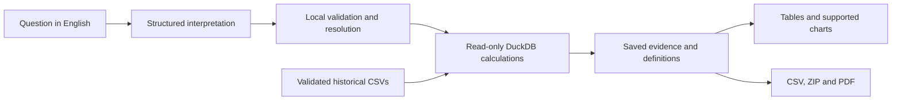

<div align="center">

# Interactive Airport Data Platform

### From everyday questions to evidence-backed aviation insights.

Explore airport connections, uncover delay patterns, compare airlines, and understand
aircraft activity through natural-language questions and reproducible local calculations.

**Natural-language analytics · Interactive exploration · Evidence-backed reports**

[Get started](QUICKSTART.md) · [Explore example questions](QUESTION_GUIDE.md) · [Engineering documentation](docs/technical/README.md)

</div>

---

## See it in action

https://github.com/user-attachments/assets/19f88a4d-dd8d-44a4-9461-b715317674ca

A recorded walkthrough of the platform in use. Expand the video above to watch the demo.

## Ask a question. Understand the answer. Keep the evidence.

Airport data becomes useful when analysts can move from a question to an explanation
without writing a query for every new idea.

This platform turns English questions into validated analytical definitions, calculates
results against a historical NYC-area dataset, and presents the answer alongside its
scope, exact results, and limitations.

**The language model interprets the question. Local code calculates the answer.**

| Explore | Questions the platform helps answer |
|---|---|
| **Airport connectivity** | Which airports connect to the most distinct destinations or neighboring airports? |
| **Flight activity** | Which calendar month has the most recorded departures? How does activity vary by weekday? |
| **Departure delays** | Which month accumulates the most delay? How does hourly delay correlate with weather? |
| **Airline comparisons** | Which airlines operate the most distinct flight numbers? How does known-seat capacity compare? |
| **Aircraft insights** | Which manufacturers and models are represented by the most distinct aircraft? |

> Built for exploration of the supplied historical snapshot—not live flight tracking.
> Weather analysis describes association, not causation.

## A workflow built for exploration

### 1. Ask naturally

Start with a question such as:

> Which calendar year-month had the most recorded departures across all origins?

Choose a local Ollama model or an explicitly configured hosted model. Questions can
contain up to four independently scoped analyses.

### 2. Inspect and refine

Review the logical interpretation, selected measure, grouping, period, and population.
Resolve ambiguity with focused clarification, or use supported local editors to adjust
scope and analytical definitions.

### 3. Explore the evidence

Read exact tables, observation counts, exclusions, and limitations. Enable the visual
preview for supported saved-evidence charts: rankings, trends, distributions,
comparisons, and relationships.

### 4. Save and share the result

Reopen private reports, download CSV evidence and PDF reports, or create a reduced
shared copy when deployment policy and session consent permit it.

## What makes it different

| Capability | Why it matters |
|---|---|
| **Grounded calculations** | Results come from validated, parameterized DuckDB queries—not model-generated numerical answers. |
| **Meaning you can inspect** | Flight records, distinct flight numbers, daily means, and distinct aircraft have explicit, different definitions. |
| **Evidence that travels** | Saved reports retain source identity, scope, definitions, missingness, and analytical revision. |
| **Local or hosted inference** | Use Ollama locally, or explicitly select OpenAI-compatible/Groq inference with processing disclosures and budget controls. |
| **Multi-section reports** | Combine up to four analyses while preserving each section's scope, outcome, and failure status. |
| **Useful exports** | Download result CSVs, supporting-evidence ZIP bundles, and V2 tagged PDFs with tables and supported charts. |
| **Private history** | Owner-scoped access retains the latest ten private reports per analyst. |
| **Controlled reuse** | FAQ and improvement copies have separate, reversible session-purpose permissions. |

### Visual reporting preview

Set `AIRPORT_VISUAL_REPORTING_ENABLED=true` to enable supported browser charts above
the exact evidence tables. The flag defaults to `false`; analytical exploration remains
available without it.

Charts read saved results, without another model call or analytical query. When evidence
cannot support a visual, the table remains available with an explicit explanation.
Advanced chart-preference persistence and full accessibility acceptance remain in progress.

### Tagged PDF export

V2 PDFs support single- and multi-section reports, include the original question, and
carry document language, heading/table structure, and chart alternative text.
Acknowledged incomplete reports preserve failed sections and their reasons.

WeasyPrint requires native Pango libraries. If they are missing, the app explains why PDF
download is disabled; browser evidence and CSV exports still work. There is no silent
untagged V2 fallback. Structural tagging is implemented, not manually certified.

See [export architecture and native runtime setup](docs/technical/exports.md).

## How it works



**A constrained analytical pipeline, not unrestricted text-to-SQL.**

The model receives the question and approved schema/catalog context, not source rows
or database access. The application validates the proposal and owns the query templates,
calculations, report construction, and export behavior.

<details>
<summary><strong>Technology stack</strong></summary>

| Layer | Technology |
|---|---|
| Application | Python 3.12, Streamlit |
| Analytical engine | DuckDB |
| Contracts | Pydantic, JSON Schema |
| Model integration | LangChain, Ollama, OpenAI-compatible APIs, Groq |
| Visuals | Altair/Vega-Lite; legacy Plotly |
| Reports | WeasyPrint/Pango for V2 PDFs; ReportLab for V1 |
| Persistence | SQLite |
| Engineering | pytest, Ruff, Docker |

Read the [component map](docs/technical/architecture.md) for module responsibilities
and the [request lifecycle](docs/technical/request-lifecycle.md) for the end-to-end flow.

</details>

## Development setup

**Prerequisites:** Python 3.12, the five supplied source CSVs, and a configured model
service. Sign-in uses OIDC, or an explicit trusted-local-machine development bypass.

```powershell
py -3.12 -m venv .venv
.\.venv\Scripts\python.exe -m pip install -e ".[dev]"
if (-not (Test-Path ".env")) {
    Copy-Item ".env.example" ".env"
}
```

For a local demo, configure these values in `.env`:

```dotenv
AIRPORT_MODEL_PROVIDER=ollama
AIRPORT_MODEL_NAME=llama3.1:8b
AIRPORT_DEV_SIGN_IN_ENABLED=true
AIRPORT_PRODUCTION=false
AIRPORT_VISUAL_REPORTING_ENABLED=true
```

With Ollama installed and its service running:

```powershell
ollama pull llama3.1:8b
.\.venv\Scripts\python.exe -m streamlit run app.py --server.address=127.0.0.1
```

Open `http://127.0.0.1:8501` and select **Sign in as local developer**.
This bypass uses one shared development identity: never expose it through a public
bind, proxy, or tunnel. It also enables consent-controlled reuse testing; review the
visible session sharing choices before generating reports.

**Prefer a hosted model?** Follow [Groq setup](QUICKSTART.md#groq-free-plan-setup).
Hosted inference needs credentials, verified free-plan configuration or bounded paid
rates, and processing acknowledgement. Model selection never switches automatically.

The [quickstart](QUICKSTART.md) covers full setup and OIDC.
The [configuration reference](docs/technical/configuration.md) explains all settings,
including appropriate token ceilings for larger hosted prompts.

## Run with Docker

The supplied image includes Python 3.12 and native PDF dependencies.

```powershell
docker build --target runtime -t airport-analytics .
```

Container use requires **OIDC configuration**: its `0.0.0.0` bind intentionally cannot
use the loopback-only development bypass. Mount secrets and durable state rather than
putting them in the image. Local environment files, secrets, usage history, and generated
report artifacts are excluded from the build.

See the [deployment guide](docs/technical/deployment.md#docker) for the run command,
volume mounts, host Ollama connectivity, and health checks.

## Safety and privacy boundaries

- **No model-generated SQL execution.** Only locally validated catalog operations become
  parameterized read-only queries.
- **Owner-scoped history.** OIDC issuer/subject claims produce a pseudonymous analyst key.
  The development bypass is not real authentication.
- **Bounded hosted usage.** Inference and enabled metered tracing share a deployment-wide
  cap of at most USD 10 per UTC month. Provider quotas remain separate.
- **Deliberate external processing.** Provider notices remain visible. Tracing is off
  by default and requires separate configuration, disclosure, and bounded cost.
- **Separate sharing permissions.** Deployment sharing defaults off. Where permitted,
  session sharing and processing acknowledgements default on; these defaults are not
  proof of an affirmative user click. Users can turn them off.
- **Honest retention behavior.** Withdrawing reuse permission stops future sharing;
  already-shared copies remain. Production reuse requires retention/deletion approval.

For caching, pacing, bounded 429 retries, and reservation reconciliation, read
[model integration and budgets](docs/technical/hosted-inference.md).
For access and sharing rules, read [identity and consent](docs/technical/identity-and-consent.md).

## Validation

Local calculations, request state, ownership, provider failure modes, and exports have
dedicated automated tests. Model interpretation quality is evaluated separately.

```powershell
.\.venv\Scripts\python.exe -m pytest tests -q -p no:cacheprovider
.\.venv\Scripts\python.exe -m ruff check src tests app.py
```

**Known test gap:** the full collection includes unfinished visual-preference tests.
Recent passing baseline runs explicitly excluded that module. Native PDF tests can skip
when Pango is unavailable; live-provider testing requires explicit authorization.
See [testing and evaluation](docs/technical/testing-and-observability.md) for exact commands,
exclusions, and the difference between local correctness and release acceptance.

## Status

**Functional single-host MVP, with visual reporting in preview.**

Implemented capabilities include natural-language exploration, locally calculated analytics,
multi-section evidence-backed reports, private history, consent controls, and exports.
Hosted-provider integrations have mocked transport coverage and selected live checks;
full provider/model acceptance remains a separate gate.

Current boundaries:

- English-language analysis of the supplied historical snapshot, not live/global aviation data.
- Calendar daily means need reviewed completeness evidence; explicitly selected recorded
  operating-day means are a different denominator.
- Weather correlations may be provisional when units are unverified; unit-dependent
  comparisons need verified evidence.
- Known-seat capacity is a reference-based proxy, not booked or remaining seat availability.
- Advanced visual preferences, full manual accessibility validation, analyst usability
  sessions, and production retention approval remain outstanding.
- No high-availability, concurrency-throughput, uptime, or response-time SLA is claimed.

Track implementation versus acceptance in the
[exploration acceptance record](specs/002-natural-language-exploration/acceptance-results.md),
[visual acceptance record](specs/003-visual-reporting/acceptance-results.md), and
[production retention checklist](docs/privacy-data-retention.md).

## Documentation

| Start here | For |
|---|---|
| [Quickstart](QUICKSTART.md) | Installation, sign-in, model setup, and first report |
| [Question-writing guide](QUESTION_GUIDE.md) | Supported questions, metric meaning, and refinement tips |
| [Technical documentation](docs/technical/README.md) | Thirteen focused engineering guides with architecture and source links |
| [Configuration example](.env.example) | Local configuration template; never commit real credentials |
| [Specifications](specs) | Feature requirements, contracts, design decisions, and acceptance work |

---

**Ask naturally. Calculate locally. Understand the evidence.**
