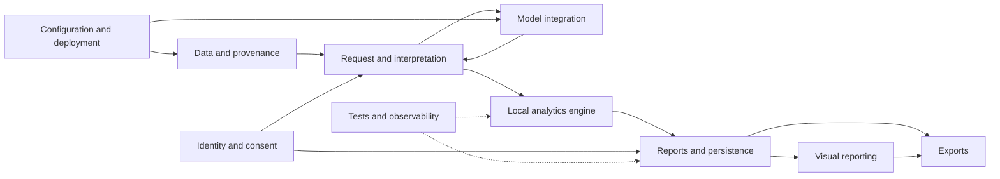

# Application technical documentation

Engineering documentation for the **Interactive Airport Data Platform**.
Start with the architecture, then follow a request from its source data through interpretation,
calculation, saved evidence and presentation. Individual guides are intentionally separated
by responsibility; they link to the implementation and to related guides.

## Scope and status

- **Application/package:** version 0.1.0, Python 3.12.
- **Reviewed:** 2026-10-18, including the current uncommitted implementation.
- **Audience:** engineers developing, testing, deploying and operating the application.
- **Authority:** these guides describe current code. Feature specifications also include
  unimplemented targets; they are not proof that a feature is complete.
- **Validation boundary:** documentation is not a production-readiness certificate,
  security audit, accessibility certification, or guarantee of model interpretation quality.
- **Sensitive information:** examples contain no real credentials. Local environment/secrets
  files and private report contents are not copied into this documentation.

## Guides

| Guide | What it explains |
|---|---|
| [Architecture and component map](architecture.md) | System boundaries, runtime diagram, process/session/durable state, every application module, dependency roles and packaging. |
| [Source data and provenance](data-and-provenance.md) | Five CSV contracts, `faa` airport joins, source validation, snapshots, semantic context, calendar coverage and weather units. |
| [Request lifecycle and interpretation contracts](request-lifecycle.md) | Streamlit reruns, request sequence, clarification, stale events, refinement, session state, V1/V2 schemas and entity resolution. |
| [Analytics engine and metric semantics](analytics-engine.md) | Supported operations, exact counting/weighting rules, daily denominators, delay/capacity/aircraft/weather calculations, compiler and bounded execution. |
| [Model integration, token usage, and budgets](hosted-inference.md) | Ollama/OpenAI/Groq integration, prompt/schema transport, interpretation cache, pacing/retry, reservation formula, settlement and reconciliation. |
| [Reports, persistence, and retention](reports-and-persistence.md) | V1/V2 evidence models, revisions, incomplete acknowledgement, SQLite schema, version decoding, ownership, preference concurrency and backups. |
| [Visual reporting and presentation](visual-reporting.md) | Saved visual evidence, default/compatible views, fingerprints, selection caps, accessibility alternatives and unfinished preferences. |
| [CSV, ZIP, and PDF exports](exports.md) | Preview versus expanded data, bound export confirmations, bundle layout, chart-evidence API, tagged PDFs, native runtime and resource restrictions. |
| [Identity, authorization, and consent](identity-and-consent.md) | OIDC, development bypass, provider disclosure versus sharing grants, audit events, reduced shared copies and production policy gates. |
| [Configuration reference](configuration.md) | Environment precedence, all application configuration groups, defaults, cost bounds, feature flags, tracing and evaluation switches. |
| [Local setup and deployment](deployment.md) | Windows setup, existing environment usage, Ollama, OIDC secrets, native PDF dependencies, Docker, mounts, health checks and operating boundaries. |
| [Testing, evaluation, and observability](testing-and-observability.md) | Safe logs, timing, troubleshooting, test layers, commands, known exclusions, independent numeric oracles and explicit live evaluation. |
| [Extension guide, limitations, and glossary](engineering-guide.md) | How to add/change metrics, providers, groupings, charts and storage; engineering checklist; known gaps and definitions. |

## How the parts connect

| Integration/connection | Read these guides together | Invariant to understand |
|---|---|---|
| Browser to interpretation | [Request lifecycle](request-lifecycle.md) + [model integration](hosted-inference.md) | A rerun is not a new request; model output is a proposal, not query authority. |
| CSVs to query results | [Data/provenance](data-and-provenance.md) + [analytics](analytics-engine.md) | Counts depend on grain, valid joins, scope, weighting and the pinned source/context. |
| Provider to usage ledger | [Model/budget integration](hosted-inference.md) + [configuration](configuration.md) | Bound exposure before dispatch; rejected and uncertain acceptance are different. |
| Numerical result to historical report | [Analytics](analytics-engine.md) + [reports/persistence](reports-and-persistence.md) | Saved evidence must retain the definition, source, revision, scope and limitations. |
| Report to chart/download | [Visuals](visual-reporting.md) + [exports](exports.md) | Render saved evidence without silently substituting fresh sources. |
| Private report to shared copy | [Reports](reports-and-persistence.md) + [identity/consent](identity-and-consent.md) | A separate purpose/session grant is required; deleting private history does not retract copies. |
| Local app to deployed runtime | [Configuration](configuration.md) + [deployment](deployment.md) | Container paths/authentication/native dependencies differ from a trusted loopback development run. |
| Feature implementation to release claim | [Testing](testing-and-observability.md) + [limitations](engineering-guide.md) | Mocked transport and numeric tests do not replace live interpretation or human acceptance. |

## Suggested reading paths

### New application engineer

1. [Architecture](architecture.md).
2. [Data and provenance](data-and-provenance.md).
3. [Request lifecycle](request-lifecycle.md).
4. [Analytics engine](analytics-engine.md).
5. [Reports and persistence](reports-and-persistence.md).
6. [Testing and engineering changes](testing-and-observability.md).

### Model/provider engineer

[Model integration](hosted-inference.md) -> [configuration](configuration.md) ->
[interpretation contracts](request-lifecycle.md#interpretation-contracts-v1-and-v2) ->
[evaluation](testing-and-observability.md#testing-and-evaluation).

### Presentation/export engineer

[Report evidence](reports-and-persistence.md) -> [visual reporting](visual-reporting.md) ->
[export contracts](exports.md) -> [change recipes](engineering-guide.md).

### Deployment/operator

[Configuration](configuration.md) -> [deployment](deployment.md) ->
[identity/consent](identity-and-consent.md) -> [budget reconciliation](hosted-inference.md#reconciliation-procedure) ->
[troubleshooting](testing-and-observability.md#observability-and-troubleshooting).

## Related documentation

- [Project README](../../README.md): product summary and entry points.
- [Quickstart](../../QUICKSTART.md): guided user/developer startup.
- [Question-writing guide](../../QUESTION_GUIDE.md): analyst-facing vocabulary and examples.
- [Production retention checklist](../privacy-data-retention.md): explicitly unapproved policy decisions.
- [Initial feature specifications](../../specs/001-airport-analytics-platform).
- [V2 exploration specifications](../../specs/002-natural-language-exploration).
- [Visual reporting specifications](../../specs/003-visual-reporting).

Some earlier setup text, UI captions and evaluation metadata predate current implementations.
The individual guides flag these inconsistencies and distinguish planned, implemented,
mock-tested and externally accepted behavior.
