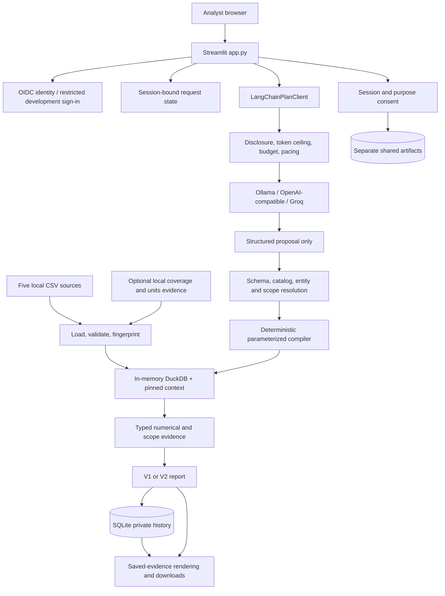

# Architecture and component map

[Documentation home](README.md) | [Next: Source data and provenance](data-and-provenance.md)

Implementation reference: 2026-10-18. See [scope and status](README.md#scope-and-status).

- [System overview and boundaries](#system-overview-and-boundaries)
- [Runtime architecture](#runtime-architecture)
  - [Process, session, and durable state](#process-session-and-durable-state)
  - [Trust boundaries](#trust-boundaries)
- [Repository and component map](#repository-and-component-map)
  - [Entry points and cross-cutting modules](#entry-points-and-cross-cutting-modules)
  - [Analytical layer](#analytical-layer)
  - [Data, report, and persistence services](#data-report-and-persistence-services)
- [Dependencies and packaging](#dependencies-and-packaging)

## System overview and boundaries

The application answers English questions about a supplied historical NYC-area flight
snapshot. A language model proposes a structured interpretation. Local Python code validates
that interpretation, resolves catalog identities, constructs parameterized queries, calculates
results in DuckDB, and builds evidence-backed reports. Streamlit presents those reports and
their private history.

The central separation is:

> The model proposes analytical intent; application code owns analytical definitions,
> data access, calculations, report evidence, authorization, and exports.

The app is **not** a free-form text-to-SQL executor. It is also not a live flight tracker,
booking system, operational weather predictor, or general-purpose BI query endpoint.

| Responsibility | Implementation |
|---|---|
| Browser interaction, sign-in, forms, report selection | Streamlit application |
| Natural-language interpretation | Ollama or an explicitly selected hosted provider through LangChain |
| Approved analytical vocabulary and SQL expressions | Local catalog and compiler |
| CSV validation and analytical execution | In-memory DuckDB |
| Typed request/result/report contracts | JSON Schema plus Pydantic |
| Durable reports, consent audit, budget ledger | Local SQLite |
| Saved-evidence charts | Altair/Vega-Lite; legacy Plotly path |
| V1 PDF | ReportLab |
| V2 tagged PDF | WeasyPrint, Pango, bundled fonts, SVG chart rendering |

There is no separately implemented REST service, background job queue, distributed task
worker, or dedicated frontend bundle. Python methods are internal interfaces, not network APIs.
Long model requests, pacing waits, queries, and export generation run synchronously within
the Streamlit request/rerun workflow.
## Runtime architecture

### Process, session, and durable state

| Lifetime | Examples | Important consequence |
|---|---|---|
| Streamlit rerun | settings object, repositories, model-client wrapper, UI render | A widget interaction reruns the script; code must not dispatch a model merely because it reran. |
| Browser session | session ID, disclosure choices, pending request, active report, prepared downloads | Clearing/signing out loses transient state, not saved reports. |
| Process cache | validated executor, storage wrapper, interpretation LRU, token-rate windows | Reused across reruns and potentially users; not durable or coordinated across processes. |
| SQLite | report JSON, consent events, shared copies, usage reservations | Survives process restart when the same database file is retained. |
| Source/evidence files | CSVs, optional coverage/units declarations and evidence | Content changes produce a different analytical binding. |

The application caches `_storage()` with `st.cache_resource`. `_snapshot_executor()` is also
a cached resource, limited to two entries. Its key includes source fingerprints and optional
coverage/unit declaration bytes, not just a directory name. A second fingerprint check
rejects files that changed during validation.

The model-client wrapper is recreated during reruns. Its default interpretation cache and
rate pacer are module-level shared objects, allowing reuse to survive wrapper recreation.

### Trust boundaries

- Question text, clarification text, model output, and entity names are untrusted inputs.
- Model responses cannot introduce SQL identifiers or arbitrary expressions.
- Filter values are query parameters; identifiers and expressions come from local allowlists.
- Reference data is validated before joins so duplicate keys cannot silently multiply facts.
- Saved reports are decoded and validated on read, not treated as arbitrary trusted JSON.
- Historical rendering reads saved evidence; it must not silently substitute today's sources.
- OIDC identity and repository ownership are separate from model-provider acknowledgement.
- Optional shared reuse is separate from both private analysis and provider processing.
## Repository and component map

Paths below are relative to the project root.

### Entry points and cross-cutting modules

| Path | Responsibility and useful entry points |
|---|---|
| [app.py](../../app.py) | `main`, cached executor/storage construction, provider controls, pending clarification UI, editors, report/history selection, sharing, downloads. |
| [config.py](../../src/airport_analytics/config.py) | Frozen `Settings`, environment parsing, provider and cost-bound configuration checks. |
| [models.py](../../src/airport_analytics/models.py) | Plans, proposals, resolved interpretations, evidence variants, report envelopes, preferences, provenance, acknowledgements, export selections. |
| [errors.py](../../src/airport_analytics/errors.py) | Typed `PlatformError` hierarchy and user-safe messages. |
| [storage.py](../../src/airport_analytics/storage.py) | SQLite schema initialization, additive migrations, read/transaction contexts. |
| [auth.py](../../src/airport_analytics/auth.py) | `AnalystIdentity`, stable OIDC identity hashing, ownership check, loopback development identity. |

### Analytical layer

| Path | Responsibility |
|---|---|
| [model_client.py](../../src/airport_analytics/analytics/model_client.py) | Provider adapters, prompt/schema transport, token counting, rate pacing, interpretation reuse, inference/tracing reservation and settlement. |
| [provider_policy.py](../../src/airport_analytics/analytics/provider_policy.py) | Per-session hosted-provider/model disclosure signature and enforcement. |
| [budget.py](../../src/airport_analytics/analytics/budget.py) | `BudgetLedger`, reservations, monthly cap/quota authorization, uncertainty, release, settlement. |
| [question_validation.py](../../src/airport_analytics/analytics/question_validation.py) | Nonempty question boundary and length validation. |
| [plan_schema.py](../../src/airport_analytics/analytics/plan_schema.py) | JSON decoding, JSON Schema validation, typed model/catalog validation for both contracts. |
| [entity_resolution.py](../../src/airport_analytics/analytics/entity_resolution.py) | Code/name/alias resolution against pinned local references; ambiguity and spelling candidates. |
| [interpretation.py](../../src/airport_analytics/analytics/interpretation.py) | V2 proposal resolution, typed analytical definitions, scope edits, local corrections, provenance. |
| [follow_up.py](../../src/airport_analytics/analytics/follow_up.py) | Explicit follow-up scope/context handling, especially V1 compatibility. |
| [request_state.py](../../src/airport_analytics/analytics/request_state.py) | Session/request/revision state, clarification turn accounting, stale-event rejection. |
| [query_compiler.py](../../src/airport_analytics/analytics/query_compiler.py) | `CompiledQuery`, approved SQL templates, filters, joins, grouping, daily/pair/weather/listing query purposes. |
| [execution.py](../../src/airport_analytics/analytics/execution.py) | `DuckDBExecutor`, timeout/caps, snapshot binding, count/page/export execution and declared-column checks. |
| [metrics.py](../../src/airport_analytics/analytics/metrics.py) | Result evidence, definitions, scope summaries, missingness and listing support. |
| [multi_stage.py](../../src/airport_analytics/analytics/multi_stage.py) | Multi-stage analytical calculations, including daily and comparison workflows. |
| [pair_metrics.py](../../src/airport_analytics/analytics/pair_metrics.py) | Flight-pair and origin-hour weather relationship evidence and limitations. |
| [evaluation.py](../../src/airport_analytics/analytics/evaluation.py) | Explicit live evaluation CLI and numeric/interpretation comparison. |
| [evaluation_records.py](../../src/airport_analytics/analytics/evaluation_records.py) | Strict corpus, review, case-result and evaluation-run records. |

### Data, report, and persistence services

| Path | Responsibility |
|---|---|
| [catalog.py](../../src/airport_analytics/data/catalog.py) | Dataset contracts, fields, dimensions, V1 metrics, V2 operations/measures/families, joins and analytical definitions. |
| [loader.py](../../src/airport_analytics/data/loader.py) | `DatasetLoader`, CSV-backed DuckDB relations, checksums, source manifest and context construction. |
| [validation.py](../../src/airport_analytics/data/validation.py) | Schema/grain/numeric checks, uniqueness, reference and weather join coverage. |
| [coverage.py](../../src/airport_analytics/data/coverage.py) | Snapshot-bound complete-day evidence and eligible daily denominator calculation. |
| [units.py](../../src/airport_analytics/data/units.py) | Local weather-unit declaration verification and provenance. |
| [entity_aliases.json](../../src/airport_analytics/data/entity_aliases.json) | Versioned local entity aliases. |
| [generation.py](../../src/airport_analytics/reports/generation.py) | `ReportGenerator`, `ExplorationReportGenerator`, outcomes, resolution/execution orchestration and revisions. |
| [rendering.py](../../src/airport_analytics/reports/rendering.py) | Report text/tables, limitations, saved visuals, V1 Plotly compatibility. |
| [visual_evidence.py](../../src/airport_analytics/reports/visual_evidence.py) | Canonical saved visual evidence, fingerprints, compatible/default views and selection resolution. |
| [charts.py](../../src/airport_analytics/reports/charts.py) | Deterministic chart specs and accessible visual descriptions. |
| [export.py](../../src/airport_analytics/reports/export.py) | CSV, allocated listing CSV, bundles, chart-evidence CSV, V1 and V2 PDF generation. |
| [pdf_runtime.py](../../src/airport_analytics/reports/pdf_runtime.py) | Native runtime discovery, bundled font loading, restricted resource fetcher, tagged PDF rendering. |
| [history/repository.py](../../src/airport_analytics/history/repository.py) | Version-aware report decoding, ownership, ten-report retention, preferences and shared artifact copies. |
| [consent/repository.py](../../src/airport_analytics/consent/repository.py) | Append-only grant/withdraw events. |
| [consent/service.py](../../src/airport_analytics/consent/service.py) | Deployment/session/purpose gates for shared reuse. |
| [timing.py](../../src/airport_analytics/observability/timing.py) | Context-local stage timing and content-free visual preparation telemetry. |
| [tracing.py](../../src/airport_analytics/observability/tracing.py) | Explicit LangSmith enablement, disclosure and bounded metering policy. |

Other important directories:

- [source_data](../../source_data): the five analytical input CSVs.
- [tests](../../tests): unit, integration, Streamlit UI, accessibility and performance checks.
- [specs](../../specs): feature requirements, design notes, acceptance records, tasks and runtime schemas.
- [reports](../../reports): locally generated evaluation/export artifacts; not the private-history database.
- [privacy-data-retention.md](../privacy-data-retention.md): unapproved production retention checklist.
## Dependencies and packaging

[pyproject.toml](../../pyproject.toml) is authoritative for dependency ranges. Python support is
**3.12 only** (`>=3.12,<3.13`). Setuptools uses a `src` layout and packages aliases and font
assets. The dependency declaration already includes `streamlit[auth]`, which supplies the
authentication extra; a separate legacy Authlib installation step is not normally necessary.

| Technology | Role |
|---|---|
| Streamlit `>=1.66,<2` | UI, OIDC integration, session state, cached resources, AppTest |
| DuckDB `>=1.2,<2` | Local analytical SQL over the loaded snapshot |
| Pydantic `>=2.9,<3`, jsonschema | Typed invariants and schema validation |
| LangChain core/OpenAI/Ollama adapters, OpenAI SDK, httpx | Model transport and structured-output adaptation |
| tiktoken | Hosted prompt ceiling estimation; GPT-OSS uses Harmony encoding |
| Altair `>=6.3,<7`, vl-convert-python | Vega-Lite browser charts and SVG conversion |
| Plotly | Legacy V1 interactive charts |
| ReportLab | Legacy V1 PDF |
| WeasyPrint `>=68,<69`, fonttools, native Pango | V2 tagged PDFs and font handling |
| python-dotenv | Optional local environment-file loading |
| pytest, pytest-cov, pypdf, Ruff | Development/test/inspection tools |

The reviewed `beon` environment had Python 3.12.0, Streamlit 1.66.0, DuckDB 1.5.6,
Pydantic 2.14.1, LangChain OpenAI 1.7.2, Altair 6.3.0, WeasyPrint 68.1,
ReportLab 5.0.1, pytest 8.4.2, and Ruff 0.17.1. These are observed versions, not
a dependency lockfile. Ranged dependencies and the Docker base tag do not guarantee
bit-for-bit reproducibility across future builds.

**Packaging caveat:** schema loading uses files in the repository's
[specs](../../specs) tree. The Dockerfile deliberately copies that tree and uses an
editable install. Do not assume an isolated wheel containing only Python modules can
run without also providing the runtime schema paths.

---

[Documentation home](README.md) | [Next: Source data and provenance](data-and-provenance.md)
