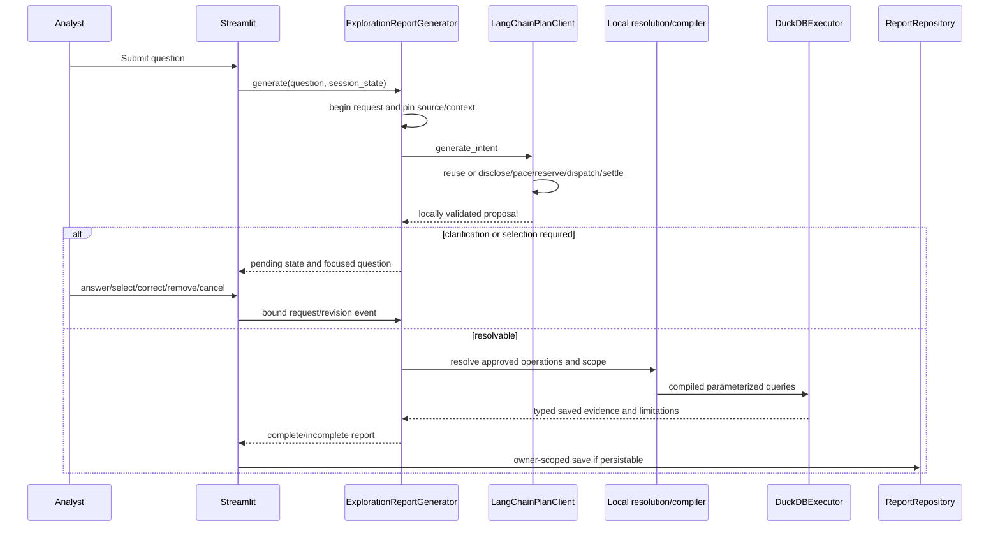

# Request lifecycle and interpretation contracts

[Documentation home](README.md) | [Previous: Source data and provenance](data-and-provenance.md) | [Next: Analytics engine and metric semantics](analytics-engine.md)

Implementation reference: 2026-10-18. See [scope and status](README.md#scope-and-status).

- [Request lifecycle and Streamlit state](#request-lifecycle-and-streamlit-state)
  - [Startup and reruns](#startup-and-reruns)
  - [V2 sequence](#v2-sequence)
  - [Pending state and clarification](#pending-state-and-clarification)
  - [Refinement and corrections](#refinement-and-corrections)
  - [Important session state](#important-session-state)
- [Interpretation contracts: V1 and V2](#interpretation-contracts-v1-and-v2)
  - [V1](#v1)
  - [V2](#v2)
  - [Local entity resolution](#local-entity-resolution)
  - [Filters](#filters)

## Request lifecycle and Streamlit state

### Startup and reruns

`main()` performs these steps:

1. Configure the page and load/validate settings.
2. Establish OIDC identity or the restricted development identity; otherwise show sign-in.
3. Establish a random session ID.
4. Construct SQLite-backed repositories, consent service and deployment budget ledger.
5. Render consent controls, shared FAQs, provider selection and disclosure.
6. Load the owner's private report list and selection.
7. Obtain a source-fingerprint-bound cached executor.
8. Construct the selected provider client and V1/V2 report generator.
9. Render the question form and any pending request.
10. On explicit submission, interpret/execute, save if eligible, and rerun.
11. Render the selected saved report or the computed-but-unsaved report.

Forms batch input changes. Buttons, checkboxes and selection controls can cause reruns;
the submission/pending-state gates prevent them from being equivalent to fresh model requests.
However, rendering can prepare exports synchronously; not every display operation is free.

### V2 sequence



### Pending state and clarification

The pending request lives under the `PENDING_REQUEST_KEY` constant from the request-state
module. State binds a session, request, revision, section and pinned source/context. An answer
for a superseded request must not change a newer one.

Important states include unresolved interpretation, clarification pending, guided correction,
failed, completed, incomplete, cancelled and superseded. The UI displays the pending clause
and clarification-turn count; answered clarification turns are bounded at three per section.
Failed clarification dispatch does not consume an answered turn.

- Structured choices can resolve locally without another model call.
- Free-text answers go through the clarification-envelope interpretation path.
- Clarification preserves other sections and their resolved fields.
- A new submitted question supersedes the previous pending request.
- More than four requested analyses requires explicit subset selection, not silent truncation.
- Section removal is explicit and recorded.
- Retry rechecks applicable disclosure, budget and source binding.

### Refinement and corrections

V1 follow-up explicitly targets a prior validated plan. V2 scope refinement explicitly targets
the displayed interpretation, not all private report history.

The UI offers:

- A single-section summary editor for approved measures, grouping, scope, ordering and bounds.
- Analytical edits for denominator, distribution bin width and comparison dates.
- Composite scope edits for selected/all sections.
- Separate presentation-only preferences.

Analytical corrections increment revision, add correction provenance, rerun calculations,
and can produce a report linked through `parent_report_id`. Presentation preference changes
do not rerun analytics or modify saved result evidence.

### Important session state

| Key or family | Purpose |
|---|---|
| `airport_session_id` | Current analysis/consent session |
| `airport_development_signed_in` | Local bypass session flag |
| `selected_model_provider`, `selected_groq_model` | Explicit sidebar selection |
| `airport_provider_disclosures`, `airport_provider_ack_choices` | Provider signatures and acknowledgement choices |
| `airport_reuse_consent` | Session/purpose consent references |
| `airport_question` | Retained question input |
| `active_report_id`, `selected_history_report`, `reset_history_selection` | Display/history routing |
| Pending request constant | Current clarification/execution lifecycle |
| `unsaved_exploration_report` | Computed result awaiting persistence/acknowledgement |
| Per-report/page/export keys | Bound listing page, allocation, confirmation and prepared bytes |
## Interpretation contracts: V1 and V2

### V1

`AnalysisPlan` is a single-analysis contract. It contains status, intent, metric ID,
grouping, filters, time range, sorting, row limit, chart intent and clarification/unsupported
text. The maximum result bound is 500; the filter count and value lists are also bounded.

Validation proceeds through:

1. JSON decoding.
2. [V1 JSON Schema](../../specs/001-airport-analytics-platform/contracts/analysis-plan.schema.json).
3. Pydantic shape/invariants.
4. Catalog metric/dimension/filter/sort compatibility.

`needs_clarification` and `unsupported` are not executable plans. A ready plan cannot choose
an unknown metric or sort by an unrelated arbitrary expression.

### V2

`IntentProposalV2` is a proposal, not executable SQL. Its five top-level keys are:

```text
intent_version, status, shared_scope, sections, selection_reason
```

Ordinary envelopes contain one to four consecutively positioned sections.
Each section identifies its original clause, status, family, operation, measures, population,
entity mentions, scope edits, grouping, dates/comparison, binning/pairing, ordering, bound,
rounding, denominator basis, and any clarification/unsupported reason.

A `requires_selection` envelope contains no sections and a nonempty selection reason.
The complete contract is the
[V2 intent schema](../../specs/002-natural-language-exploration/contracts/intent.schema.json).

Resolution converts this proposal into `ResolvedInterpretation` with:

- Approved operation/measure/family/population combinations.
- Explicit entity codes rather than untrusted names.
- Typed filters and effective dates.
- Analytical definition, calendar/grain and weighting.
- Field provenance, source/context binding, request/revision and selection.

### Local entity resolution

`EntityDirectory` normalizes Unicode, case and whitespace, then tries exact codes,
canonical names and local aliases. Ambiguous names produce candidate codes. Misspellings can
produce suggestions, but suggestions never silently become scope filters.

Reference-only entities, observed entities and unmatched-reference observations are distinct.
Alias content is hashed into the relevant context; changing aliases is a semantic change.

### Filters

Filterable fields and types are catalog-defined. `in` requires a nonempty list and `between`
requires two values; value lists are capped at 100. Dates are ISO dates, numeric inputs must
be finite, and null comparisons have explicit SQL null semantics. Filters remain conjunctions
of approved typed conditions, not arbitrary analyst expressions.

---

[Documentation home](README.md) | [Previous: Source data and provenance](data-and-provenance.md) | [Next: Analytics engine and metric semantics](analytics-engine.md)
